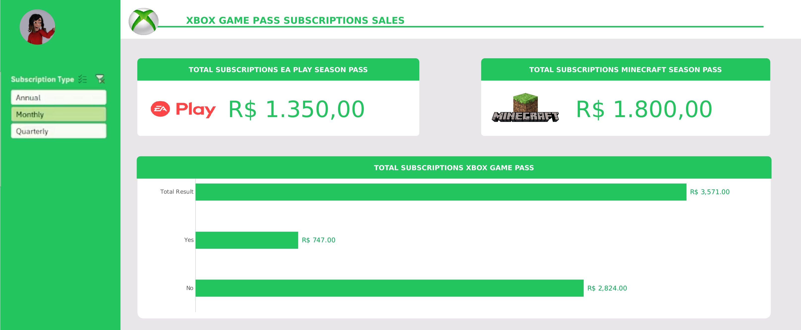

# 🎮 Dashboard de Vendas — Xbox Game Pass

Dashboard interativo construído inteiramente no **Excel** para analisar as vendas de assinaturas do Xbox Game Pass, incluindo os complementos **EA Play** e **Minecraft Season Pass**.



## 📌 Sobre o projeto

O objetivo é responder perguntas de negócio sobre o faturamento das assinaturas a partir de uma base com **295 assinantes**, organizando tudo em um painel visual, limpo e filtrável.

### Perguntas de negócio respondidas

1. Qual o faturamento total das assinaturas (todas agregadas)?
2. Qual o faturamento separado por **auto renovação** (sim / não)?
3. Qual o total de vendas do **EA Play Season Pass**?
4. Qual o total de vendas do **Minecraft Season Pass**?

## 📊 Principais indicadores

> Valores exibidos com a segmentação **Subscription Type = Monthly** selecionada.

| Indicador | Valor |
| --- | --- |
| Total de assinaturas Xbox Game Pass | R$ 3.571,00 |
| Com auto renovação (Yes) | R$ 747,00 |
| Sem auto renovação (No) | R$ 2.824,00 |
| Total EA Play Season Pass | R$ 1.350,00 |
| Total Minecraft Season Pass | R$ 1.800,00 |

Ao trocar a segmentação (Monthly, Quarterly, Annual), todos os indicadores e o gráfico se atualizam.

## 🛠️ Ferramentas e recursos utilizados

- **Microsoft Excel**
- **Tabelas dinâmicas** para consolidar os dados por plano e por auto renovação
- **Segmentação de dados** (slicer) por tipo de assinatura (*Subscription Type*)
- **Gráfico dinâmico** de barras
- **Formatação** personalizada: paleta de cores inspirada no Xbox, cartões de KPI, ícones e logos

## 🗂️ Estrutura do arquivo

O arquivo possui quatro abas:

| Aba | Conteúdo |
| --- | --- |
| **Assets** | Paleta de cores, logos e ícones usados no painel |
| **Bases** | Base de dados com 295 assinantes (plano, data de início, auto renovação, preços, cupons e valor total) |
| **Cálculos** | Tabelas dinâmicas que respondem às perguntas de negócio |
| **Dashboard** | Painel final com os KPIs e o gráfico |

> As abas *Assets*, *Bases* e *Cálculos* ficam ocultas; apenas o *Dashboard* aparece ao abrir o arquivo.

### Campos da base

`Subscriber ID` · `Name` · `Plan` (Core, Standard, Ultimate) · `Start Date` · `Auto Renewal` · `Subscription Price` · `Subscription Type` (Monthly, Quarterly, Annual) · `EA Play Season Pass` · `EA Play Season Pass Price` · `Minecraft Season Pass` · `Minecraft Season Pass Price` · `Coupon Value` · `Total Value`

## ▶️ Como usar

1. Baixe o arquivo [`dashboard_xbox.xlsx`](dashboard_xbox.xlsx).
2. Abra no **Microsoft Excel** (2010 ou superior, necessário para a segmentação de dados).
3. Use a segmentação de dados para filtrar por tipo de assinatura.

> ⚠️ A segmentação de dados não funciona em versões muito antigas do Excel, no Google Planilhas nem no LibreOffice.

## 📁 Estrutura do repositório

```
.
├── assets/
│   └── dashboard_xbox.png
├── dashboard_xbox.xlsx
└── README.md
```

## 👤 Autor

Feito por **Karolina Elizabete**
